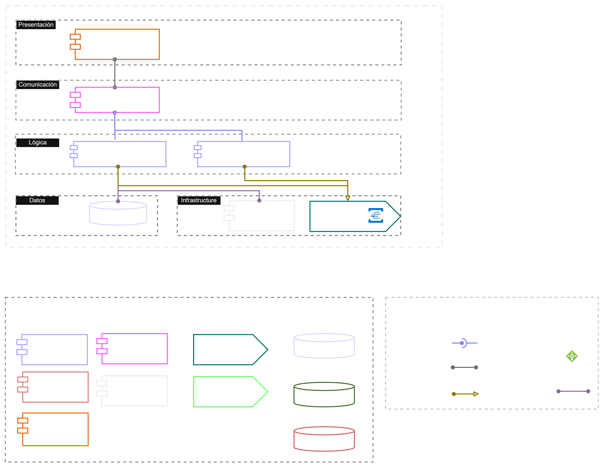

# Proyecto de curso — Fundamentos de DevOps y SRE (2026-02)

Universidad Nacional de Colombia — Facultad de Ingeniería — Posgrados en Ingeniería de Sistemas y Computación.

Este repositorio contiene el proyecto del curso: empaquetar, aprovisionar, gobernar y operar en alta disponibilidad un sistema FOSS de grado empresarial, construyendo su plataforma de CI/CD y su marco de observabilidad y SRE.

El sistema seleccionado es [Taiga](https://taiga.io), una plataforma de gestión ágil de proyectos.

El diagrama de componentes y conectores is: 

## Origen del código

**El código bajo `src/` no fue escrito por este equipo.** Fue tomado de los repositorios oficiales de Taiga ([github.com/taigaio](https://github.com/taigaio)) con fines exclusivamente académicos, en los siguientes commits:

| Componente | Repositorio de origen | Versión | Commit | Licencia |
| --- | --- | --- | --- | --- |
| `src/taiga-back` | [taigaio/taiga-back](https://github.com/taigaio/taiga-back) | 6.10.2 + 29 commits (`main`, 2026-09-28) | `c8264ac6775103cbcc2a3a145978f2b475e9ff05` | MPL 2.0 |
| `src/taiga-front` | [taigaio/taiga-front](https://github.com/taigaio/taiga-front) | 6.10.3 + 13 commits (`main`, 2026-10-01) | `fbce70d1ce5508bf9285e166b7df1168bca622ef` | AGPL 3.0 |
| `src/taiga-events` | [taigaio/taiga-events](https://github.com/taigaio/taiga-events) | 6.10.0 (2026-04-20) | `e411856df4653dccdd727994b0d957db28d15770` | MPL 2.0 |
| `src/taiga-protected` | [taigaio/taiga-protected](https://github.com/taigaio/taiga-protected) | 6.10.1 (2026-05-18) | `3fc1f92b75290d5c41fdd14c7d647aeeb68338a2` | MPL 2.0 |

Cada componente conserva sus archivos `LICENSE`, `AUTHORS.rst` y `CHANGELOG.md` originales. Los derechos de autor pertenecen a Kaleidos INC y a los contribuidores de Taiga.

### Modificaciones respecto al código de origen

Para que todo el trabajo de DevOps de este repositorio sea propio del equipo, se eliminó de cada componente:

- El historial de git del proyecto original (el historial de este repositorio empieza desde cero).
- `docker/` y `.dockerignore` (Dockerfiles, entrypoints y plantillas de configuración para contenedores).
- `.github/` (workflows de GitHub Actions, plantillas de issues y configuración del repositorio de origen).
- `.travis.yml` (en `taiga-protected`).

El código de aplicación no fue modificado.

## Estructura

```
src/
  taiga-back/        API (Python / Django); depende de PostgreSQL y RabbitMQ
  taiga-front/       Cliente web (AngularJS / CoffeeScript)
  taiga-events/      Servidor de eventos en tiempo real por WebSocket (Node.js); depende de RabbitMQ
  taiga-protected/   Servicio de verificación de URLs firmadas para adjuntos (Python)
```
